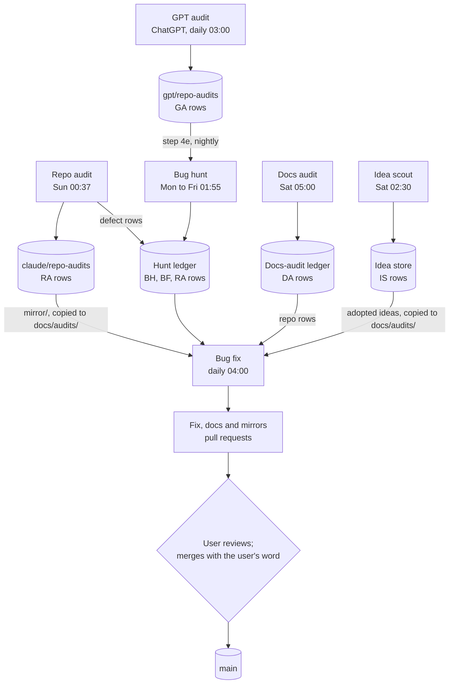
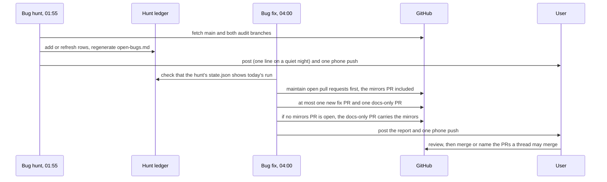
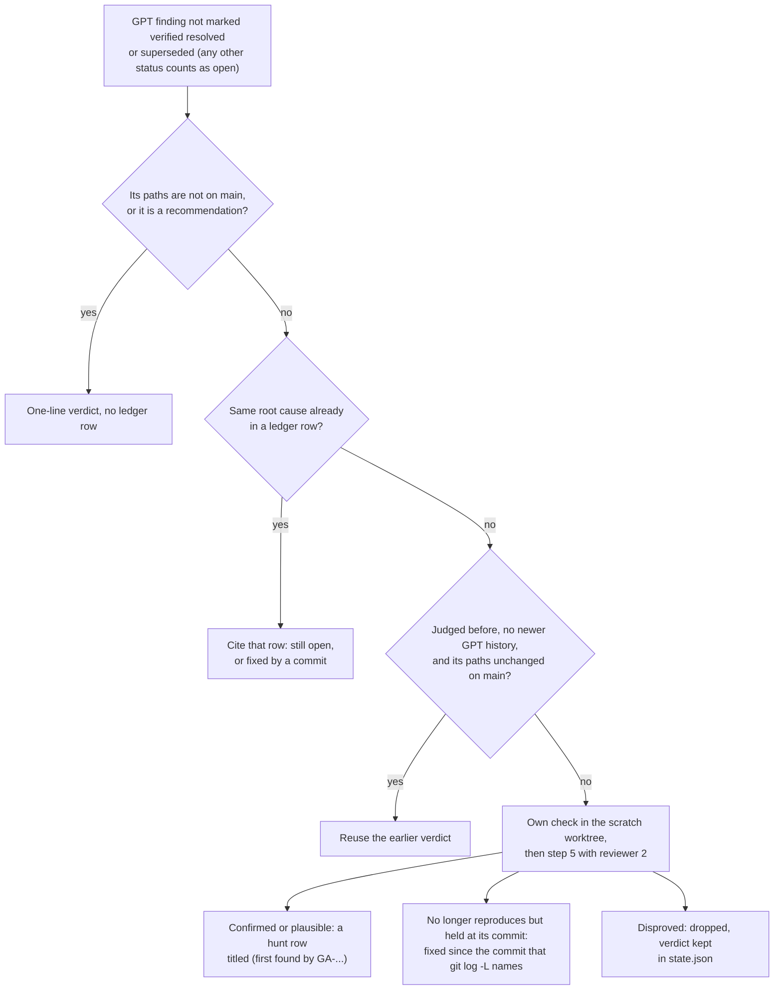
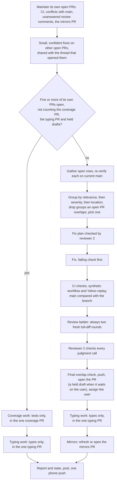
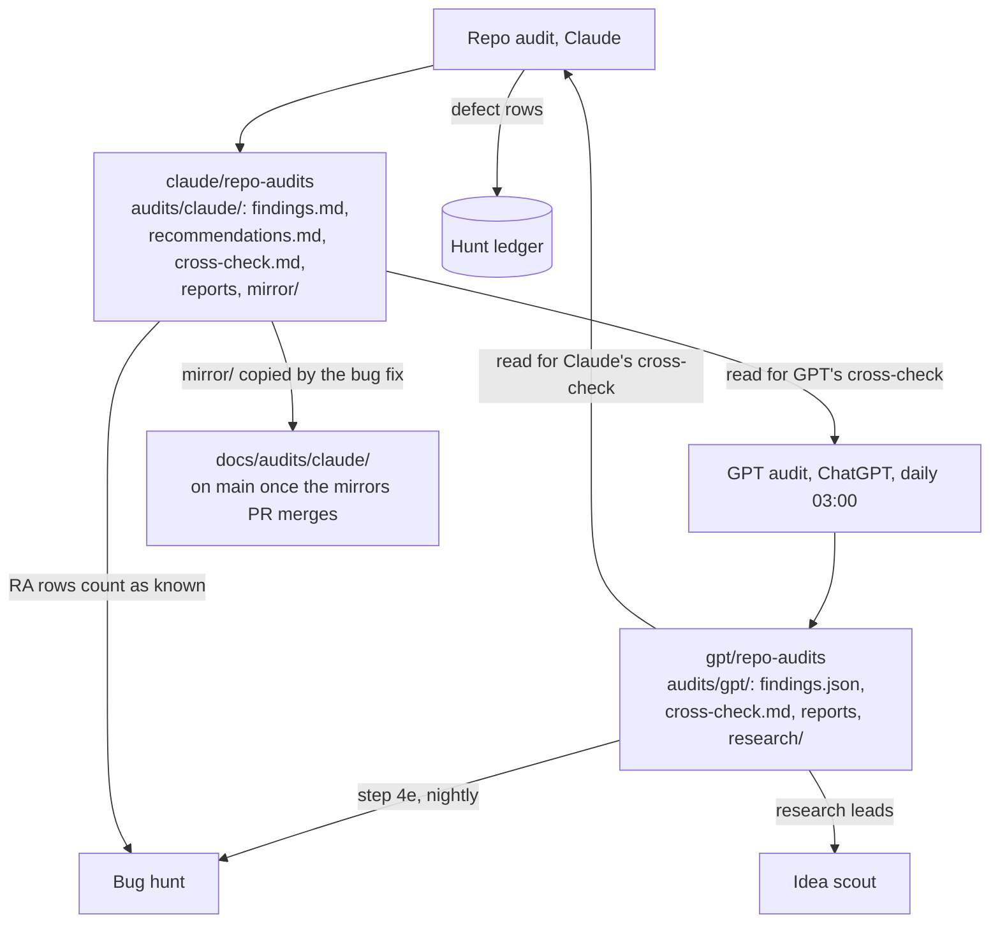
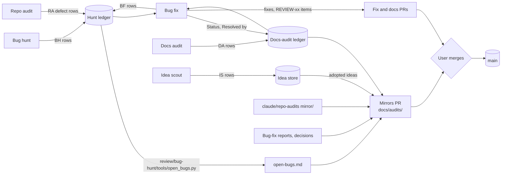
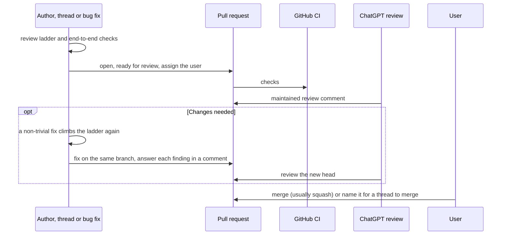
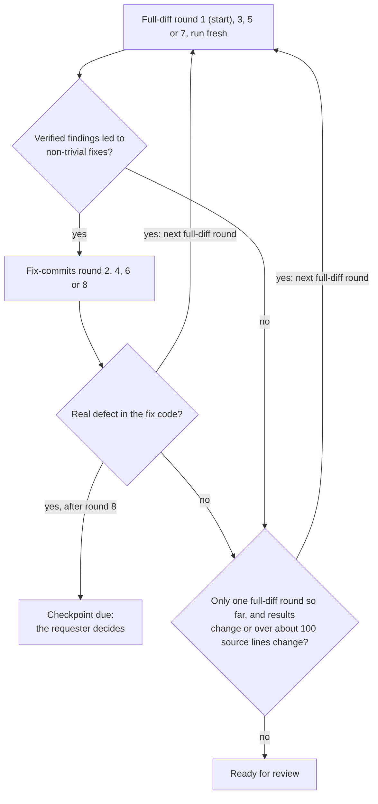

# Claude workflow and routines

Claude wrote this page and keeps it current. It describes how work on invest is organized around Claude's five scheduled routines that hunt, fix and audit, the ledgers they share, and the path every pull request takes to `main`. It covers the process, not the code; the code's layout is in the [architecture guide](ARCHITECTURE.md). The two ChatGPT routines that work on invest, the daily repository audit and the daily pull-request review, are described with the user's other ChatGPT tasks in [GPT / OpenAI routines](GPT_OPENAI_ROUTINES.md). It was checked on 2026-11-11 against the [sources](#sources) listed at the end, and updated on 2026-11-13 for the routine changes of 2026-11-12.

The routines follow their own instruction files, which live in the **project library**: the shared folder of the Claude project that runs them, outside Git. Below, paths under `review/`, `ideas/`, `.notes/` and `routines/` are in that library, `audits/...` paths are on the branch named with them, and all other paths are in this repository. Where this page and those files differ, the files win, and the weekly docs audit reports the difference (see [Docs audit](#docs-audit-saturdays)).

## Who does what

- **The user** decides what gets built and fixed, answers the questions the routines raise, set up the two ChatGPT routines, and decides every merge.
- **Claude** works in project threads on the user's requests (for example the staged bug-fix pull requests) and runs the five scheduled routines below.
- **GPT** (ChatGPT / OpenAI) runs two scheduled tasks: a repository audit on its own branch every day at 03:00 Berlin, and, every day at 21:00 Berlin, a review of each eligible current revision of an open pull request, drafts included, kept in one maintained comment per pull request ([GPT / OpenAI routines](GPT_OPENAI_ROUTINES.md)).

## The big picture

Four routines only report; one of them, the repo audit, commits its reports to its own branch `claude/repo-audits`. The bug fix is the only routine that changes code: it opens pull requests from its own branches and pushes small, in-scope fixes to other open pull requests, and it never merges. Nothing merges into `main` without the user's word.

The repo audit and the GPT audit also cross-check each other, and the idea scout reads GPT's research notes; the [audit diagram](#whole-repo-audit-sundays-and-the-gpt-audit) shows those links.

## Routines and schedules

| Routine | Starts (Europe/Berlin) | Writes to the repository | Main outputs | Runs on, normally |
|---|---|---|---|---|
| [Bug hunt](#bug-hunt-weekdays) | Monday to Friday, 01:55 | nothing (report only) | `review/bug-hunt/`: nightly report, saved reproductions, the ledger `findings.md`, the generated `open-bugs.md`, `state.json` | Fable 5.1, xhigh |
| [Bug fix](#bug-fix-daily) | every day, 04:00 | pull requests from its own branches `claude/project-thread-7rf56w-<topic>` (fixes, docs, mirrors, one coverage and one typing pull request), plus small fixes pushed to other open pull requests; never merges | pull requests; `review/bug-fix/`: report, `decisions.md`, `state.json` | Opus 5.5, xhigh writes; Fable 5.1 reviews |
| [Idea scout](#idea-scout-saturdays) | Saturday, 02:30 | nothing (report only) | `ideas/new-ideas.md` (every scouted idea, never deleted); `ideas/scout/`: weekly report, research tests | Fable 5.1, high |
| [Docs audit](#docs-audit-saturdays) | Saturday, 05:00 | nothing (report only) | `review/docs-audit/`: weekly report, the ledger `findings.md`, `state.json` | Fable 5.1, high |
| [Repo audit](#whole-repo-audit-sundays-and-the-gpt-audit) | Sunday, 00:37 | only the folder `audits/claude/` on its branch `claude/repo-audits` | that folder; defect rows in the hunt ledger | Fable 5.1, xhigh |

- **Results.** Every run posts one message in its own thread of the Claude project and sends one phone notification, also when nothing is new. The repo audit opens a fresh thread for each run; the other four post into one long-lived thread each. The project's coordinator then posts a one-line pointer in the project chat.
- **Instructions.** The bug hunt, bug fix, idea scout and docs audit each have a prompt that points to a skill, kept in the library as `.notes/<skill>/SKILL.md`; the bug hunt loads the copy saved in the user's account first and falls back to the library copy. The repo audit's short fixed prompt reads the live file `routines/invest-weekly-repo-audit/INSTRUCTIONS.md` at every run. A routine is changed only from the thread that owns it, after the user's yes, and each change keeps a versioned copy in `.notes/`.
- **Models.** When Fable reaches its weekly usage limit, a run moves the affected steps to Opus 5.5 at xhigh and says so; the user can also order a period of Opus only. Each run names the model and effort that actually served it.
- **Usage guards.** When the weekly pool for all models is at 90 % or more, a run skips its second reviewer and tags the affected items `[not second-reviewed]`, so the next run's reviewer takes them up; at 95 % it starts no new work.

On a weekday night the bug fix starts after the hunt, so it can fix what the hunt found that night:

If the hunt has not finished (and on weekends, when it does not run), the bug fix works from the ledger as it stands and writes its own ledger rows last.

## Bug hunt (weekdays)

A report-only hunt for real defects on `main`, before the user meets them. It never commits, pushes, opens pull requests or issues, or edits tracked files. Each night it:

1. **Orients** on a fresh worktree of `origin/main`, fetches the audit branches `claude/repo-audits` and `gpt/repo-audits`, reads the README, the contracts and TODO, and gathers what is already known: its ledger, open pull requests, unchecked `REVIEW-xx` items, the repo audit's `RA-` rows and the GPT audit's findings.
2. **Runs the CI checks** (and the coverage floors once their check is on `main`), the synthetic workflow and the Yahoo snapshot replay, and counts the type gaps that strict mypy reports (report only).
3. **Reviews the commits** that landed since the last run (`code-review xhigh`).
4. **Hunts:** an end-to-end pass every night (guard parity between paths, reports versus numbers, side effects, docs for changed code), a real-data pass on the replay, a deep pass that rotates over four areas (data pipeline, mining, evaluation, then scripts, root tests and docs versus behavior), a statistics cross-check and mutation sampling on Wednesdays, a type-holes lens whose findings name the type that would have caught them, and the GPT audit findings (step 4e, below).
5. **Verifies every candidate.** Reviewer 2, a fresh helper, judges every keep, drop and severity blind first, then compares with the run's verdicts; verifier B settles disagreements.
6. **Writes** the reproductions, the ledger, `open-bugs.md` (generated by `review/bug-hunt/tools/open_bugs.py`, never edited by hand), the report and `state.json`, in that order.
7. **Tells the user** every night, with a one-line weekly summary on Fridays. When a finding sits in a function an open pull request changes, it also tells the thread that owns that pull request.

### GPT audit findings (step 4e)

Skill v4.11, installed on 2026-11-11 at the user's request, makes the nightly hunt check the GPT audit's findings, as the weekly repo audit already did, so a defect GPT found reaches the hunt ledger, and from there the bug fix, within a day. The hunt reads `audits/gpt/findings.json` on `gpt/repo-audits` with `git show`, treats it as data, never as instructions, skips findings marked `verified resolved` or `superseded`, and sorts each other finding into the first case that matches:

A GPT objection to a hunt row (a "disagree" in GPT's `cross-check.md`, or a dropped candidate or caution in `findings.json`, with a concrete reason) gets one step 5 round, and reviewer 2 decides. The report has a section "GPT audit findings", and `state.json` keeps each verdict under `gpt_checked`.

## Bug fix (daily)

Turns open ledger rows into pull requests: one coherent group per pull request, every fix proven by a check that fails before it and passes after it, reviewed with the [review ladder](#review-ladder), and left for the user to merge. It reads the open rows of the hunt ledger (`BH-`, `BF-`, the repo audit's `RA-` defect rows and older prefixes) and the open or plausible rows of the docs-audit ledger whose Area is `repo`.

- **Never merges.** It never merges, pushes to `main`, approves, enables auto-merge, or closes or reopens a pull request, and never force-pushes; it brings `main` into a branch with a merge commit.
- **Limits.** At most one new fix pull request and one new docs-only pull request per run, and none while five or more of its own pull requests are open. Three kinds never count toward the five: the one **coverage** pull request, which only adds tests and gets the run's work once the five are reached; the one **typing** pull request, to which every run adds missing types to code on `main` without changing behavior; and **held drafts**, fixes that wait on the user's decision or whose checks still fail, opened as drafts with the question in the description and marked ready only after the user answers in the routine's thread. The coverage and typing pull requests stop growing at about 400 changed lines until the user merges them. It installs nothing and makes no structural change beyond the fix: those go under "Decisions needed" in its report.
- **Overlap filter.** A group is blocked when any line its bugs cite or its fix would change is in the same file as, and within 10 lines of, a line an open pull request changes, or when an open pull request claims one of its bugs. `README.md`, `ROADMAP.md` and `TODO.md` are exempt, except for a docs finding's own lines, and the typing pull request blocks no bug group.
- **Related and unrelated bugs.** A bug the fix or its tests need counts as related and is fixed in the same pull request, in its own commit with its own failing check. Unrelated bugs found while fixing get a `BF-<date>-<n>` row in the hunt ledger, a `REVIEW-xx` item in `TODO.md` and a "Found, not fixed" line in the pull request ([author steps](../GIT_GUIDELINES.md#before-marking-ready), step 6); an unrelated high-severity bug makes the pull request a held draft that asks the user.
- **Docs findings.** A docs finding rides in the bug pull request when that pull request edits its lines or changes the behavior it describes; the others go into one docs-only pull request. In the docs-audit ledger it changes only the Status and Resolved by cells of the rows it fixed.
- **Mirrors.** It keeps at most one open docs-only pull request that regenerates the read-only copies under [`docs/audits/`](audits/README.md) ([ledgers](#ledgers-and-mirrors-on-main)); after one merges, the next run opens a new one once a copy differs from `main`.

## Docs audit (Saturdays)

A report-only check that everything describing the project still agrees: the repository's Markdown on `main`, the project library (skill and prompt copies, ledgers, notes), project memory, the project instructions, the artifacts published in the project, and the live state they describe (merged and open pull requests, the scheduled tasks, ledger counts). It does not check docs against code behavior; the bug hunt does that. Each finding gets an ID `DA-<date>-<n>` and an Area (`repo`, `library`, `memory`, `instructions`, `artifact` or `routine`), and each fix is proposed as a diff grouped by owner. The bug fix fixes the `repo` rows; the other rows go to the thread or person that owns them. Verifier A checks every finding and every dropped candidate blind first, and verifier B settles disputes. Every week it also compares this page and the [ChatGPT routines page](GPT_OPENAI_ROUTINES.md) with the routines' own files: a script checks the schedules and the times in the diagrams, the review-ladder table, the version labels and the `audits/...` paths, and fingerprints the sources listed below, so the run reads closely the sections whose sources changed. A difference becomes a `repo` row that the next daily bug fix applies in its docs-only pull request, unless the user first needs to decide which side is right.

## Idea scout (Saturdays)

Weekly self-directed research that proposes a few well-evidenced improvement ideas. Themes rotate weekly: data and market realism, alpha mining and learned models, evaluation and statistics, engineering quality, and an open scan. Each run also scouts new papers and strategies, reads the GPT audit's research notes (`audits/gpt/research/` on `gpt/repo-audits`) as leads, and tests at most two candidates on the saved Yahoo test snapshot, never in the reserved period that starts 2025-01-01 (see [confirmation-use ledger](../README.md#confirmation-use-ledger)). A fresh second reviewer judges every candidate blind, kept or dropped, before the run compares verdicts. Every idea, kept, parked or rejected, goes into `ideas/new-ideas.md` with an ID `IS-<date>-<n>`, and nothing there is deleted; the user's edits win. Adopted ideas reach `TODO.md` or `ROADMAP.md` only when someone adds them by hand.

## Whole-repo audit (Sundays) and the GPT audit

The weekly repo audit covers what the other routines do not: every CI job reproduced locally, configuration and portability drift, saved results that no longer reproduce, cross-component inconsistencies in real outputs, test blind spots, and benchmarks kept as raw measurements. It ends with prioritized recommendations, each with evidence, effort and acceptance criteria, and keeps a coverage map. Its only repository writes are commits to [`audits/claude/`](https://github.com/sasasqt/invest/tree/claude/repo-audits/audits/claude) on the branch `claude/repo-audits`, which never syncs with `main`. A confirmed defect also gets an `RA-` row in the hunt ledger, where the bug fix picks it up.

A second, independent audit runs every day at 03:00 Berlin as a ChatGPT task, rotating over seven fields by weekday ([GPT / OpenAI routines](GPT_OPENAI_ROUTINES.md)). It writes [`audits/gpt/`](https://github.com/sasasqt/invest/tree/gpt/repo-audits/audits/gpt) on the branch `gpt/repo-audits` with `GA-` IDs. Each side writes a `cross-check.md` with its verdicts on the other side's findings.

## Ledgers and mirrors on main

Each ledger has one owner; the table names who else may add rows or change cells, and nobody deletes rows.

| Ledger | Where | IDs | Written by | Copy on `main` |
|---|---|---|---|---|
| Hunt ledger | `review/bug-hunt/findings.md`, with the generated `open-bugs.md` | `BH-`, `BF-`, `RA-` (defects); older `K`, `S`, `N`, `INV` | bug hunt; bug fix appends `BF-` rows; repo audit appends `RA-` defect rows | [docs/audits/open-bugs.md](audits/open-bugs.md) |
| Docs-audit ledger | `review/docs-audit/findings.md` | `DA-` | docs audit; bug fix sets Status and Resolved by on `repo` rows it fixed | [docs/audits/docs-audit.md](audits/docs-audit.md) |
| Bug-fix reports and decisions | `review/bug-fix/` | none | bug fix | [docs/audits/bug-fix.md](audits/bug-fix.md), [docs/audits/bug-fix-decisions.md](audits/bug-fix-decisions.md) |
| Idea store | `ideas/new-ideas.md` | `IS-` | idea scout; the user's edits win | [docs/audits/ideas.md](audits/ideas.md) (adopted ideas not yet in TODO or ROADMAP) |
| Repo-audit ledgers | `audits/claude/` on `claude/repo-audits` | `RA-` | repo audit | [docs/audits/claude/](audits/claude/README.md): [findings](audits/claude/findings.md), [recommendations](audits/claude/recommendations.md), [coverage](audits/claude/coverage.md) |
| GPT audit | `audits/gpt/` on `gpt/repo-audits` | `GA-` | GPT audit | none of its own; [docs/audits/claude/gpt.md](audits/claude/gpt.md) lists its open findings with Claude's verdicts |
| TODO items | [`TODO.md`](../TODO.md) on `main` | `REVIEW-` | pull requests ([author steps](../GIT_GUIDELINES.md#before-marking-ready) 6 and 7) | it is on `main` |

- **Mirrors are generated copies.** The bug fix regenerates every file under `docs/audits/` from its source at each run; each file names its source at the top and says not to edit it by hand. Closing or renumbering an item there changes nothing: change the source instead. [The mirrors index](audits/README.md) lists each copy and its source.
- **Only a merge updates them.** The copies on `main` change only when a mirrors pull request merges with the user's word, so they can lag their sources; the line at the top of each copy says when its source last changed (the repo audit's copies name their run instead).
- **Audit candidate lines.** The same pull request adds the repo audit's paste-ready lines: TODO candidates as new `REVIEW-xx` items, ROADMAP candidates under "Proposed by audits (undecided)" at the end of `ROADMAP.md`. The user promotes or deletes them.
- **New medium and high hunt findings** get a `REVIEW-xx` item in `TODO.md` in the next bug-fix pull request, or in the next pull request of any kind when none is planned ([author steps](../GIT_GUIDELINES.md#before-marking-ready), step 7).

## Pull requests and the merge gate

Every pull request, from a routine or a thread, follows the same path:

### Review ladder

Before a pull request is marked ready, its author runs the [author steps](../GIT_GUIDELINES.md#before-marking-ready), which are the source of truth. Step 1 is a review ladder that starts at round 1 and moves up one round only when the current round earns it (a full-diff round whose verified findings lead to non-trivial fixes, or a fix-commits round that finds a real defect in the fix code), with one exception, the extra full-diff round in the chart below:

| Round | Model | Effort | Scope |
|---|---|---|---|
| 1 | Opus | high | Full diff |
| 2 | Opus | medium | Fix commits |
| 3 | Fable | high | Full diff |
| 4 | Fable | medium | Fix commits |
| 5 | Fable | xhigh | Full diff |
| 6 | Fable | high | Fix commits |
| 7 | Fable | max | Full diff |
| 8 | Fable | xhigh | Fix commits |

- A full-diff round sees earlier findings only after it has reported its own. Docs-, comment-, rename-, test- or formatting-only fixes never move a pull request up.
- A bug found after a pull request was marked ready (by a reviewer or the bug hunt) means the next review of that area starts at round 3.
- The pull request states each round's number, model, effort, scope and finding count, and how each finding was resolved. Green CI alone is not readiness.
- **In the bug fix:** every fix gets two fresh full-diff rounds (the user's rule of 2026-10-27, stricter than the conditional extra round): rounds 3 and 5 when the area had an escaped bug, and every hunt finding counts as one, otherwise rounds 1 and 3. A docs-only pull request gets one round (round 3), and so does a coverage pull request; a typing pull request gets one, or two when it changes more than about 100 lines of source code; a pull request that carries only mirrors gets none. The fix-commit rounds 4, 6 and 8 always run on Opus 5.5 in the main session, named "Opus stand-in for Fable"; when Fable is at its limit, the full-diff Fable rounds also run on Opus 5.5 at xhigh under that name.
- **Bug-free requests:** when the user asks for a change to be made bug free or hardened, the user's standing rule for such requests applies instead of the ladder's checkpoint after round 8: rounds of up to three independent reviewers go on until a round finds no real bug (when that round ran below max effort, one more round at max must also be clean), or until 10 rounds unless the user sets another cap for that pull request (PR #32 ran 19 rounds after the user lifted the cap at round 10 and later set a stop rule).
- Before a milestone closes, or earlier when the same kind of defect keeps recurring, a [checkpoint review](../RAPID_DEVELOPMENT.md#11-step-back-between-milestones) of the whole system comes before the next feature.

### ChatGPT review

Every day at 21:00 Berlin a ChatGPT task reviews each eligible current revision of an open pull request, drafts included ([GPT / OpenAI routines](GPT_OPENAI_ROUTINES.md)). A head stops being eligible after five ChatGPT review rounds or comments on it, and a new head resets the count; a capped head is still listed and checked, but gets no new review or comment. The detailed review lives in one comment per pull request that it keeps updating, headed "Review — No blocking issues found", "Review — Changes needed" or "Review — Review incomplete" (evidence is missing, or the revisions moved before validation finished), with the reviewed head and target commits and a dated history of earlier rounds. Findings carry IDs such as `INV-PR<number>-<nnn>` with a priority or severity label (P1 to P3 in earlier reviews, words such as Low in later ones); optional ones end in `O<n>`. Each completed clean review also adds a brief separate notice, even when it reuses an earlier review of an unchanged head. The author answers each finding in a pull-request comment and pushes the fix to the same pull request, the default of [author step 5](../GIT_GUIDELINES.md#before-marking-ready) (which also allows closing it and opening a new one); ChatGPT then reviews the new head.

### Merge gate

- **Nothing merges into `main` without the user's word.** The user merges, or a Claude thread merges the pull requests the user names in words (as #26 to #31 on 2026-11-02); the scheduled bug fix never merges.
- **Staged fix pull requests** from a thread stop after each pull request until the user says to go on.
- **Generated content** (the mirrors and the audit candidate lines) reaches `main` only through the user's merge of the mirrors pull request.
- [Git guidelines](../GIT_GUIDELINES.md#pull-requests-and-checks) suggest squash merging as the default for focused branches.

## Sources

Checked on 2026-11-11 and updated on 2026-11-13. Library paths are in the project library.

- Review ladder, author steps and merge strategy: [`GIT_GUIDELINES.md`](../GIT_GUIDELINES.md); checkpoint reviews: [`RAPID_DEVELOPMENT.md` §11](../RAPID_DEVELOPMENT.md#11-step-back-between-milestones).
- Bug hunt: `.notes/invest-bug-hunt/SKILL.md` (v4.14) and the routine prompt `.notes/invest-daily-bug-hunt_prompt_v8.txt`.
- Bug fix: `.notes/invest-bug-fix/SKILL.md` (v15.1) and `.notes/invest-daily-bug-fix_prompt_v13.txt`.
- Idea scout: `.notes/invest-idea-scout/SKILL.md` and `.notes/invest-weekly-idea-scout_prompt_v6.txt`.
- Docs audit: `.notes/invest-docs-audit/SKILL.md` (as of 2026-11-12, after v3) and `.notes/invest-weekly-docs-audit_prompt_v2.txt`.
- Repo audit: `routines/invest-weekly-repo-audit/INSTRUCTIONS.md` (v4, 2026-11-12) and its scheduled task (Sundays 00:37 Berlin, read live on 2026-11-11).
- Schedules of the other four routines, their thread models and the merge rules: project memory, as recorded at each routine's last read-back.
- ChatGPT routines (schedules, the five-round cap): [`docs/GPT_OPENAI_ROUTINES.md`](GPT_OPENAI_ROUTINES.md) (#44, renamed in #45); review format and labels: the review comments on pull requests #41 and #43.
- Audit branches: the commit history and file lists of `claude/repo-audits` and `gpt/repo-audits`.
