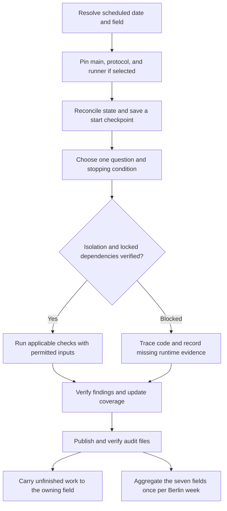
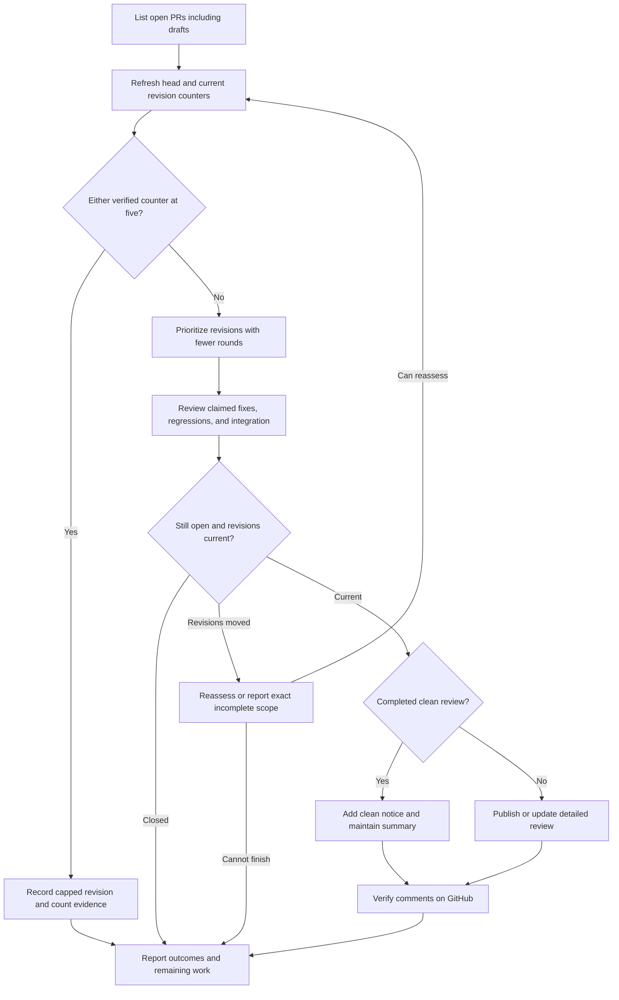
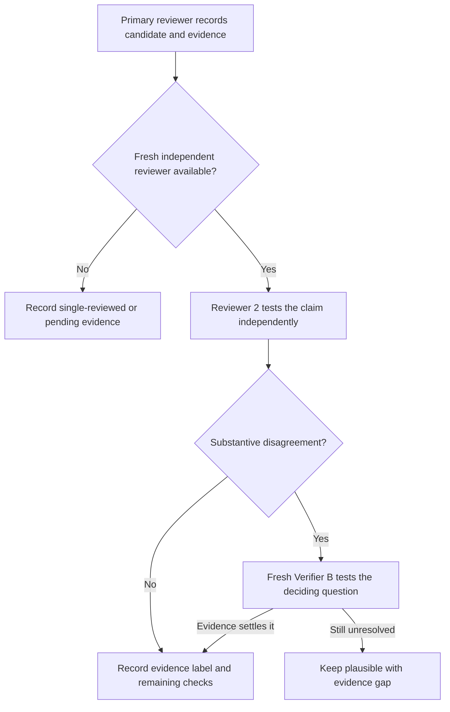
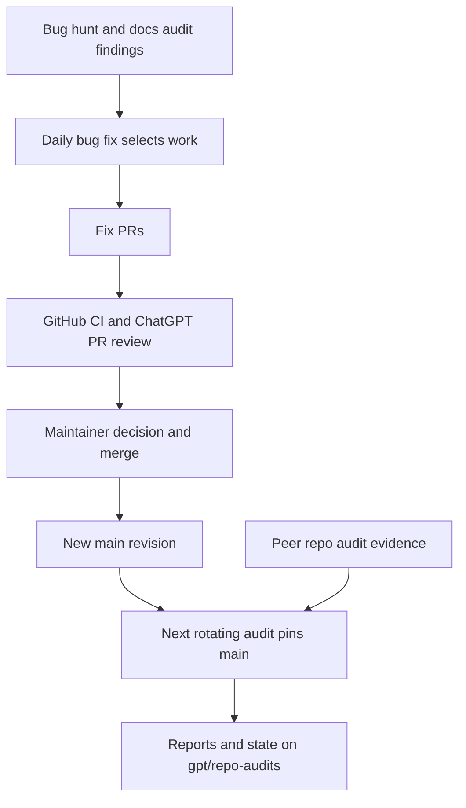

# Invest routine workflow

This guide records the two ChatGPT routines for `sasasqt/invest` and their handoffs with GitHub CI and the peer routines, as verified on **11 November 2026**.

| Enabled ChatGPT task | Schedule (`Europe/Berlin`) | Input | Published output |
| --- | --- | --- | --- |
| Audit invest repository | Daily at **03:00** | A pinned `main` commit, the day's field, and prior audit state | Dated report, evidence, and cumulative state under `audits/gpt/` on [`gpt/repo-audits`](https://github.com/sasasqt/invest/tree/gpt/repo-audits/audits/gpt), plus a chat result |
| Review open invest PRs | Daily at **21:00** | Open PRs, including drafts, with their head and target commits | PR Conversation comments and a daily chat summary |

## 03:00 · Rotating repository audit

| Berlin day | Primary field |
| --- | --- |
| Monday | Data integrity and point-in-time correctness |
| Tuesday | Factor mining and statistical validity |
| Wednesday | Strategy evaluation and financial accounting |
| Thursday | Integration, artifacts, reporting, and recovery |
| Friday | Engineering, interfaces, and delivery |
| Saturday | Software performance, scaling, and comparator integrity |
| Sunday | Primary research scouting and falsifiable hypotheses |

- A fresh run pins `main`. A retry keeps the scheduled date, field, and source commit. The audit loads the pinned method index and the applicable modules, verifies their digests, and reconciles the current output head before work and before publication. A missing prior report is recorded as unknown unless there is evidence of an interruption.
- The planning budget is **120 minutes**: roughly 20 for setup, 70 for the field, and 30 for verification, checkpointing, and reporting. The starting discretionary reading split is 60% on carried or changed behavior and 40% on exploration, with per-field adjustments based on comparable visits. The run tracks unique coverage ranges, stable finding IDs, deferred work, and evidence freshness. A missed visit leaves work in its owning field's queue.
- Before importing, building, or testing repository code, preflight verifies the source, proves that executed code cannot access credentials, and checks the exact installed dependency graph against the lockfile. Matching-commit GitHub CI and peer results can be cited as existing evidence, with their original scope. Execution uses synthetic inputs or permitted, already-inspected pre-cutoff data. Real market or vendor observations from 1 January 2025 onward and other reserved windows are excluded.
- Preflight checks runner readiness on every visit. Friday engineering owns deeper runner investigation. On 11 November, preflight recorded both credential isolation and the exact installed locked dependency graph as unverified, so the audit completed its bounded static question and recorded zero product executions. PR [#36](https://github.com/sasasqt/invest/pull/36) had merged into the runner branch for draft PR [#32](https://github.com/sasasqt/invest/pull/32). The 10 November PR review reported no blocking issues at `44aa875` and disclosed that a full Windows-host Docker run was still unverified. The audit still needed to qualify its own execution route. [Preflight record](https://github.com/sasasqt/invest/blob/0c9863e95ab38b93fa22093e6cfdc2149b77bacc/audits/gpt/2026-11-11-evaluation/preflight.json) · [Runner review notice](https://github.com/sasasqt/invest/pull/32#issuecomment-6777952225).
- Publication is confined to `audits/gpt/` on `gpt/repo-audits`. The audit verifies the remote diff and preserves newer concurrent updates. It retains unpublished evidence if publication fails. The dated result records both the status of today's question and overall audit completion. The seven-field summary goes in Sunday's report when available, or the first subsequent report.

[Pinned audit method index](https://github.com/sasasqt/invest/blob/bab6ba12399787496ba1108a9a368e00f8643441/audits/gpt/protocol/rotation-v3-2026-11-02/index.json) · [Continuity state](https://github.com/sasasqt/invest/blob/gpt/repo-audits/audits/gpt/state.json) · [11 November report](https://github.com/sasasqt/invest/blob/0c9863e95ab38b93fa22093e6cfdc2149b77bacc/audits/gpt/2026-11-11.md) · [Publication receipt](https://github.com/sasasqt/invest/blob/0c9863e95ab38b93fa22093e6cfdc2149b77bacc/audits/gpt/2026-11-11-evaluation/publication.json)

## 21:00 · Open pull-request review

**Eligibility and order.** Keep two separate counts for the period since the PR's most recent head change: published review comments and substantive review rounds that resulted in a published comment or update. Either count reaching **five** caps that revision. Count only verifiably ChatGPT/OpenAI work, using retained comment IDs or run history for attribution. An uncertain origin is excluded and reported. A head change resets both counts, including a force-push back to an older SHA. Comment activity and CI changes leave the counts in place. Eligible revisions with zero rounds go first, then one, then two to four. Within each group, use least recently reviewed first, breaking ties by oldest PR creation time.

**Review.** Pin the head and target commits. Read the full diff in context, relevant contracts, earlier findings, author replies, and overlapping PRs. Check the claimed failure and its fix on base and head where feasible, plus integration against the target branch. Record which checks actually ran, which CI results match the reviewed revision, and what evidence is missing. Check the latest author or maintainer response before reporting that a user decision is needed.

| Conclusion | When it applies |
| --- | --- |
| Changes needed | Verified blocking findings remain. |
| No blocking issues found | The completed review supports technical readiness within its stated validation limits. |
| Review incomplete | Material evidence is missing or the relevant revisions moved before validation finished. |

**Publication.** The routine maintains one detailed top-level Conversation comment per PR, with stable finding IDs, dated history, commit-linked locations, and acceptance checks. Every eligible completed clean review adds a brief new timeline notice, including an unchanged review that reuses earlier validation. The first clean notice may also serve as the initial summary. A new qualifying notice adds one published comment. A notice that only refreshes unchanged evidence adds zero substantive rounds. Before posting, the routine rechecks open status, revisions, and caps, deduplicates by PR, head, target, and run, then verifies the comment on GitHub. If revisions move and the routine cannot finish, any incomplete review names exactly what was examined. The daily summary records reviewed, capped, deferred, and blocked PRs. This routine's write access is limited to its own PR Conversation comments. Maintainers own approvals and merges.

[Repository review guidelines](../GIT_GUIDELINES.md#when-reviewing) · [Example detailed review](https://github.com/sasasqt/invest/pull/41#issuecomment-6726530636) · [Example clean timeline notice](https://github.com/sasasqt/invest/pull/41#issuecomment-6777953452)

## Independent verification

Both routines apply this path to material new or changed candidates, including proposed drops. A PR status refresh that reuses unchanged evidence needs no fresh candidate review.

Reviewer 2 starts with the pinned source and evidence before seeing the primary reviewer's verdict. The checks cover source identity, expected and actual behavior, negative controls where feasible, impact, related code and docs, and duplicate findings. Verifier B weighs both positions and runs a decisive check if it is permitted and takes under a minute. A run can use at most two active helpers. The primary reviewer owns the final evidence labels and publication. [Pinned audit review method](https://github.com/sasasqt/invest/blob/bab6ba12399787496ba1108a9a368e00f8643441/audits/gpt/protocol/rotation-v3-2026-11-02/methods/11-findings-review.md).

## Repository handoffs and peer routines

GitHub Actions runs on PRs and pushes to `main`. The six jobs cover two Python versions, wheel installs, and three independent component installs. Both ChatGPT routines can use matching-revision CI evidence. A proposed fix becomes part of `main` after merge and can be checked against the newly pinned source. [CI workflow](../.github/workflows/ci.yml) · [CI/CD guidelines](../CI_CD_GUIDELINES.md#what-ci-checks-today).

| Peer routine | Handoff visible in the repository |
| --- | --- |
| Bug hunt | Reports defects in `main` on weekdays, according to the [repository README](../README.md). The [open bug mirror](audits/open-bugs.md) lists known items. The repository's author guidelines route new medium/high findings into `TODO.md` through a subsequent PR. |
| Weekly docs audit | Reports stale or inconsistent material; [open and plausible rows](audits/docs-audit.md) identify source, area, and resolution status. The bug-fix routine can act on repository rows. |
| Daily bug fix | Proposes changes through PRs and records decisions in its [status](audits/bug-fix.md) and [decisions](audits/bug-fix-decisions.md) mirrors. The mirrors PR refreshes the repository copies. |
| Weekly Claude repository audit | Publishes to `claude/repo-audits`; its [mirror](audits/claude/README.md) summarizes findings, coverage, and recommendations. The rotating audit can independently check relevant peer evidence. |
| Idea scout | Records research and engineering proposals. The [ideas mirror](audits/ideas.md) lists proposals marked for adoption that are absent from `TODO.md` and `ROADMAP.md`. |

The [mirror index](audits/README.md) identifies each authoritative source. Files under `docs/audits/` are generated snapshots refreshed by a merged mirrors PR. Check the source date and the current code or PR before relying on a snapshot's status.
